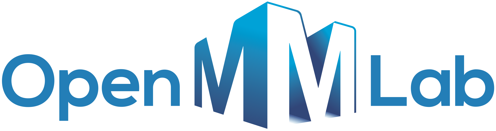

# 3D geometry and detection tools

A repository developed during my PhD studies in order to integrate a holistic 3D viewer for experimenting, as well as integrating state-of-the-art models for autonomous driving.

**[Visualization tools](viz_tools/README.md)** ·
**[Dataset loader utilities](visual_utils/README.md)** ·
**[Custom dataset tutorial](visual_utils/docs/custom_datasets.md)**

## 🚀 Install visual tools

I recommend to use Python 3.10–3.12. From the repository's root:

```bash
python -m venv .venv
source .venv/bin/activate
python -m pip install -e './visual_utils' -e './viz_tools/3dviz'
3dviz --demo
```

`3dviz` opens a local browser workspace for point clouds, detection, and LiDAR
segmentation. On a calibrated dataset, click a camera preview in the 3D scene
to review its image and overlays. [Camera review guide](viz_tools/3dviz/README.md#camera-images)

## 🔌 Integrate your own dataset

Implement one `DatasetLoader` in your own package. It adapts native storage to
shared metadata and sensor records used by the browser workspace and Python
clients. Declare point clouds, cameras, or both through capabilities.
Register the constructor in a script, or publish an installed
`visual_utils.loaders` entry point so it appears in `3dviz`.
Prediction-file adapters are a separate extension interface.

Start with the [runnable custom-dataset tutorial](visual_utils/docs/custom_datasets.md),
then consult the [loader contract](visual_utils/docs/loader_contract.md) and
[prediction-source contract](viz_tools/3dviz/docs/prediction_contract.md).

## 👾 Model Zoo

Here is a table with the performance of several models and their performance:

| Backbone |  Detection Model | mAP | NDS | Info | Link |
|--------|------------|------|------|------|---|
| LitePT | CenterHead | 59.1 | 65.6 | gt sampling OFF | soon |
| LitePT | CenterHead | 60.1 | 67.3 | gt sampling ON | soon |

## Acknowledgments



This repository builds on `OpenPCDet`, an open source project for LiDAR-based
3D object detection.
Dataset-specific notices are retained under [visual_utils/third_party](visual_utils/third_party/NOTICE.txt).
