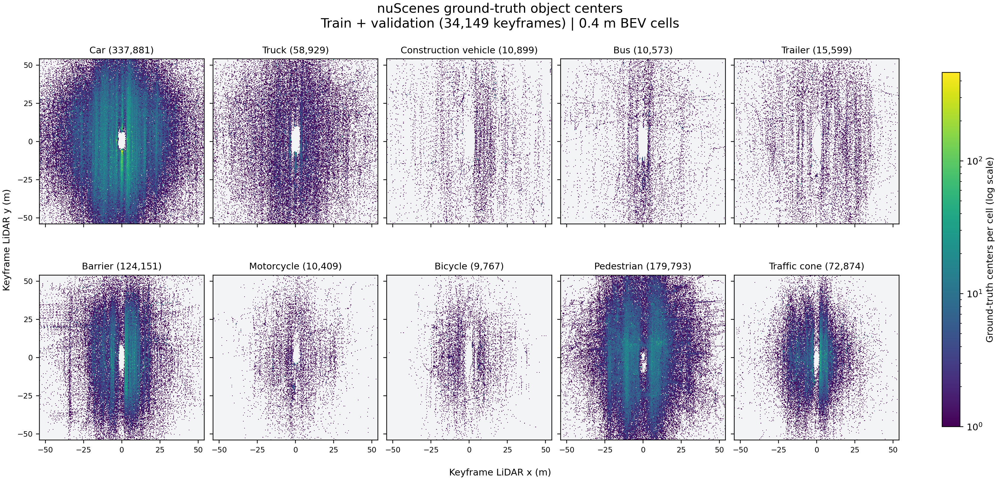

### CenterPoint performance against the GridSize

We analyzed 34,149 keyframes from both training and validation datasets of nuScenes and we select 830,875 valid ground-truth cuboids. We also applied the common ±54 m limits on X and Y axes, and we set three cell sizes, namely 0.2 m, 0.4 m, and 0.8 m. A collision counts once when two or more object centers share a cell in the same frame and prediction head (it is common to share the prediction head for several classes).

| CenterHead group | 0.2 m | 0.4 m | 0.8 m |
|------------------|-------|-------|-------|
| Car | 22 | 26 | 27 |
| Truck + Construction vehicle | 0 | 0 | 0 |
| Bus + Trailer | 0 | 0 | 0 |
| Barrier | 18 | 89 | 342 |
| Motorcycle + Bicycle | 0 | 2 | 66 |
| Pedestrian + Traffic cone | 37 | 267 | 4,553 |
| **All heads** | **77** | **384** | **4,998** |

#### Objects Heatmap in BEV Space

